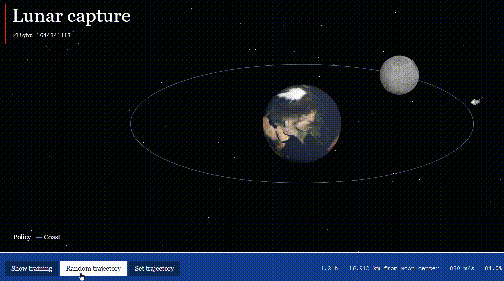

# Autonomous Lunar Orbit Capture with Deep Reinforcement Learning

A hybrid-action reinforcement-learning framework for autonomous lunar orbit capture of an Apollo 8 CSM-modeled spacecraft, trained over randomized hyperbolic approaches in a custom finite-thrust Earth-Moon simulator (variable mass, adaptive RK4, impact event detection). A PPO controller maps a 25-dimensional navigation, propellant, and engine-state observation to coast/thrust mode, 3D thrust direction, and burn/coast durations, with no reference trajectory or inference-time optimizer. Frozen checkpoints are evaluated against a matched no-burn baseline on seeded held-out approaches. A Dockerized REST API serves trajectories and burn telemetry to an interactive Three.js 3D viewer.



| Benchmark on 512 held-out approaches | Result |
|---|---:|
| Captures on fresh, random arrivals | 478/512 (93.4%) |
| Captures on the same arrivals with no burns | 0/512 |
| Impacts (policy / no burns) | 26 / 50 |
| Average burns (all flights / successful flights) | 6.82 / 7.12 |

## Project Structure

```text
.
├── lunar/
│   ├── physics.py           # gravity, propulsion, and RK4 integration
│   ├── environment.py       # shared flight environment
│   ├── tasks.py             # simulation task definitions
│   ├── capture_nominal.py   # lunar capture task and policy rollouts
│   ├── policy.py            # neural network and PPO updates
│   ├── train_capture.py     # continue training from the released policy
│   └── evaluate.py          # repeat the held-out benchmark
├── model/                   # policy.pt, model card, and confirmation records
├── results/                 # benchmark summary and paired no-burn outcomes
├── viewer/                  # REST server, replay tools, and Three.js frontend
├── tests/                   # physics, policy, and evaluation checks
├── docs/                    # hardware sources and training history
├── .github/workflows/       # automated tests
├── apollo8_source.pdf       # Apollo 8 press kit
├── apollo8_report.pdf       # Apollo 8 mission report
├── requirements.txt
└── Dockerfile
```

## Running It

From the repository root, create a Python 3.12 environment. On Windows with PowerShell:

```powershell
py -3.12 -m venv .venv
.\.venv\Scripts\Activate.ps1
python -m pip install -r requirements.txt
python -m viewer.server
```

On macOS or Linux, create the environment with `python3.12 -m venv .venv` and activate it with `source .venv/bin/activate`. Open [localhost:8765](http://localhost:8765/) once the server starts.

To run the viewer with Docker:

```sh
docker build -t lunar-capture .
docker run --rm -p 127.0.0.1:8765:8765 lunar-capture
```

To run the tests and reproduce the 512-flight benchmark in the Python environment, use a fresh output directory:

```sh
python -m unittest discover -s tests -v
python -m lunar.evaluate --output runs/full_evaluation
```

## Spacecraft and Lunar Capture Dynamics

The vehicle uses Apollo 8 command and service module masses and a fixed-thrust model of its Service Propulsion System. The engine produces about 90.7 kN at a specific impulse of 313 seconds. Each flight begins with 50–100% of the modeled 18.5-tonne propellant load. [See more](docs/HARDWARE.md)

The simulator samples an initially unbound approach 10–14 lunar radii from the Moon’s center, with a hyperbolic excess speed of 400–1,000 m/s and randomized approach orientation and lunar phase. An adaptive fourth-order Runge–Kutta integrator advances the spacecraft under Earth and Moon gravity, accounting for finite burn duration and decreasing mass. The Moon follows an inclined circular orbit. The benchmark assumes exact navigation and engine execution with instantaneous attitude changes.

Capture requires an orbit whose lowest point stays at least 50 km above the lunar surface and whose highest point stays within 10,000 km altitude. The spacecraft must hold those bounds for six hours, then pass another 24 simulated hours of unpowered verification.

## Methodology

At each decision, the controller reads 25 inputs describing navigation in a local lunar frame, spacecraft mass and fuel, engine status, and timing. Two shared 128-unit tanh layers feed a categorical coast/thrust decision, continuous controls, and a value estimate. A thrust command sets a 3D direction and a duration of 0.1–120 seconds. A coast command advances the simulation by 1–900 seconds before the next decision. Consecutive thrust commands can share one engine ignition.

During training, proximal policy optimization (PPO) samples actions and updates the policy using the likelihood of the selected mode and its active controls. The critic learns the undiscounted flight return. The advantage estimate decays with elapsed simulated time so a one-second decision and a 15-minute coast carry different weights.

Training began with seed 42 (lol) and ran for 256, 64, and 32 PPO updates across three stages. After checkpoint selection, the deterministic policy flew 512 held-out arrivals. Each arrival was also simulated with the engine off, giving the paired baseline above. Replaying the policy commands with halved integration steps preserved all 512 capture and impact classifications. [Training history](docs/PROVENANCE.md) · [Model card](model/MODEL_CARD.md)

## Interactive Viewer

**Fly an approach.** Choose *Random trajectory* to draw a new arrival or *Set trajectory* to specify the approach geometry, speed, and starting fuel. The browser sends the initial conditions to the Python REST endpoint `POST /api/flights`. The server runs the frozen policy and simulates a second flight from the same state with the engine off. It returns both time-stamped paths and the burn telemetry for playback in Three.js.

The red trail follows the controlled spacecraft. The dotted blue trail shows where it would have coasted, so you can see how each burn changes the arrival. Red arrows mark thrust directions at ignition. The telemetry panel tracks elapsed time, distance from the Moon, speed, fuel remaining, and burn count. Drag to rotate, scroll to zoom, or switch between Earth- and Moon-centered views. Click the playback dial to pause or resume and turn it to adjust speed.

**Watch training.** *Show training* samples 100 recorded flights for a 20-second montage at normal speed. Earlier paths fade as later flights appear. Two graphs track cumulative captures and the capture rate over the most recent 128 training flights. The montage closes with a successful capture and follows the spacecraft around the Moon.

## Future Work

- **Fuel efficiency.** Every successful benchmark flight emptied its tank. Optimize remaining propellant while preserving the capture rate.
- **Impact reduction.** Examine the 26 impact cases and train for safer approaches across the same arrival distribution.
- **End-to-end flight.** Extend control to departure from low Earth orbit, translunar transfer, and lunar orbit insertion.
